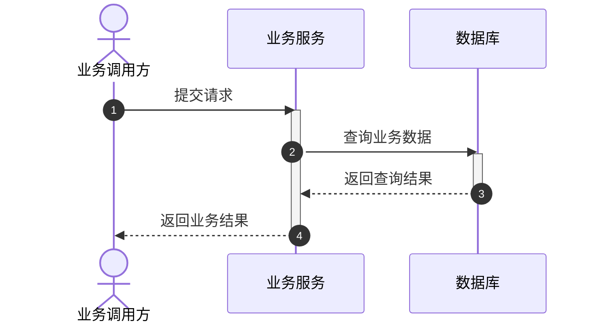

<!-- Generated from the sequence-diagram-generator Skill by scripts/sync_sequence_conventions.py; do not edit. -->

# Shared sequence diagram conventions

The sequence-diagram-generator Skill owns this common contract. It applies to
every Skill that produces sequence diagrams, including embedded overview, module,
case and scenario diagrams. Domain policies may add evidence and layout rules;
they must preserve this contract. Release synchronizes this reference into each
consumer Skill so installed Skills remain self-contained. Edit only the owner's
reference; regenerate consumer copies with scripts/sync_sequence_conventions.py.

## Participants and evidence

Every diagram uses `sequenceDiagram`, `autonumber` and at least one balanced
technical activation. Preserve the domain's rendering configuration and label
wrapping. Declare users, business callers and test initiators with `actor`; they
never receive activation blocks. Only services, middleware, databases, storage,
external technical dependencies and executors use `participant` and activation.

Bind participant identity and role to source, design or requirement evidence;
never classify from a display name or invent a component to satisfy the gate.
Structured roles are `actor`, `caller`, `service`, `middleware`, `database`,
`storage`, `external` (technical dependency) and `executor`. Conflicting roles for
one identity fail. Source steps freeze sender_role/receiver_role; proposal steps
supply those roles with the same requirement/source evidence as the step.

## Activation and control flow

Show the technical execution span for a request with `activate` / `deactivate`
or Mermaid's equivalent `+` / `-` message syntax. Pair synchronous activations
with the exact call dependency, including repeated and nested calls; close nested
calls in return order. Database spans cover the evidenced read/write operation.
Each control arm and loop body preserves its entering activation depth; no span
may leak across an alternative branch or remain open at diagram end.

Dispatch is asynchronous; it does not prove completion. At an unobserved boundary,
close the visible span with an explicit `Note` and no invented return or success.
Keep entry and background stages distinct. A root activation represents the
selected analysis window, not measured duration. When only one technical
component is evidenced, show its activation with an evidence-linked note instead
of inventing a caller, dependency or response.

## Acceptance

All domain document gates use the shared `toolkit.core.sequence.validate_sequence`
validator. Generators follow its participant and activation contract; domain
checks additionally bind messages and roles to their evidence.
Missing activation, actor activation, unknown participants, unbalanced spans or
invalid control boundaries block delivery. Run the owning domain's existing
verification and report actual render status. A missing renderer is `not_run`;
an available renderer failing blocks delivery.

Consuming these conventions does not change the domain CLI, project scope,
version file, lock or asset ownership, and grants no cross-domain write authority.
